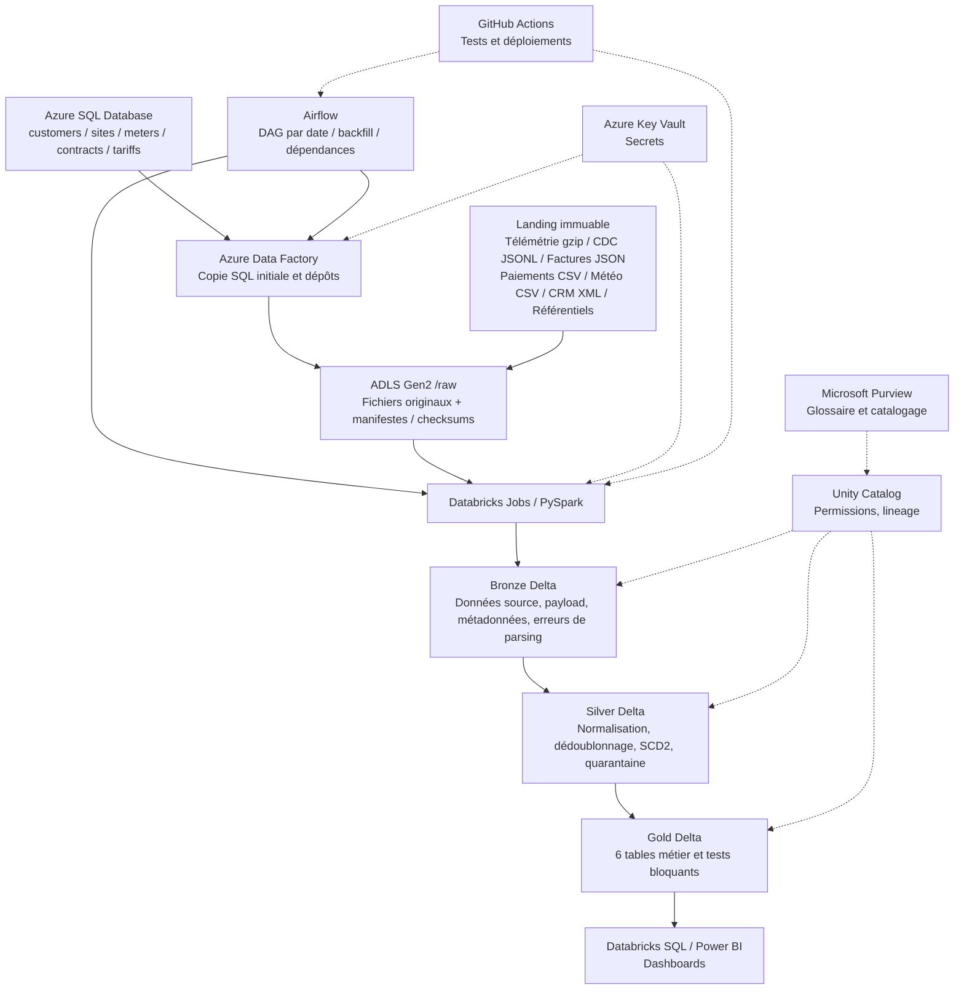

# VoltaNord Énergie — Architecture cible S1 (v0.1)

Statut : **proposition d'architecture**, non déployée. Périmètre des données : 2026-01-01 à 2026-04-30.

## Schéma logique



## Décisions techniques

1. **Source SQL** : choisir Azure SQL Database avec `voltanord_azuresql.sql`, ou PostgreSQL Azure avec le script correspondant, mais ne pas mélanger les dialectes. La base SQLite sert uniquement à l'exploration locale. Charger les cinq tables et vérifier les volumes et les contraintes avant la première copie.
2. **Stockage** : ADLS Gen2 avec espace `raw/` immuable, `bronze/`, `silver/`, `gold/`, `quarantine/` et `checkpoints/`. Les fichiers landing sont conservés à l'identique, avec SHA-256, chemin, taille, date d'ingestion et identifiant de lot.
3. **Bronze** : ingestion sans perte, y compris lignes malformées sous forme de payload brut et motif d'échec. Pour les données personnelles, accès restreint à Bronze.
4. **Silver** : harmoniser les schémas firmware, les horodatages en UTC, les dates locales `Europe/Paris`, les identifiants et les unités ; dédoublonner selon une clé métier documentée ; reconstituer les contrats depuis le snapshot du 01/01 et les événements CDC ordonnés par LSN, avec politique explicite de gestion des événements tardifs.
5. **Gold** : produire `conso_region_jour`, `thermosensibilite`, `reconciliation_facturation`, `recouvrement`, `anomalies_compteurs`, `contrats_historique`. Conserver les clés de traçabilité et versions de calcul.
6. **Orchestration** : Airflow sera l'orchestrateur de référence à partir de S5 ; ADF est limité à la copie et ne doit pas dupliquer la logique d'ordonnancement. Chaque traitement prend une `business_date` et accepte le rejeu idempotent.
7. **Sécurité** : identité managée / service principal selon les connecteurs ; secrets dans Key Vault ; RBAC Azure + permissions Unity Catalog ; les analystes n'accèdent ni à raw/bronze sensibles ni aux colonnes PII en clair ; vues pseudonymisées en Gold.
8. **Gouvernance** : Unity Catalog pour les objets Databricks, permissions et lignage compatible ; Purview pour le glossaire et le catalogage, après validation de l'intégration effective.
9. **Format de table** : Delta Lake est l'hypothèse de travail jusqu'à l'ADR S4 ; benchmark Iceberg/Delta avant décision finale.

## Points de vigilance métier

- L'index kWh est cumulatif : la consommation d'une heure est la différence entre deux index valides successifs du même compteur ; ne pas calculer à travers un reset, un remplacement ou un trou de mesure sans règle explicite.
- Le changement d'heure `Europe/Paris` entraîne des journées de 23 et 25 heures ; les heures creuses 22:00–06:00 se calculent sur l'heure locale, avec dédoublonnage par instant UTC et non par heure locale seule.
- Les contrats sont extraits au 01/01/2026, contrairement aux autres tables extraites au 30/04/2026 : éviter toute jointure temporelle qui suppose un snapshot uniforme.
- Les tarifs ont des bornes de validité inclusives et doivent être joints à la date de référence prévue par la règle de facturation.
- L'absence de certains champs n'est pas nécessairement une erreur ; chaque règle de qualité doit documenter son impact et le nombre de lignes concernées dans `QUALITE.md`.

## Checklist de validation S1

- [ ] Souscription, région Azure, groupe de ressources, tags et budget définis
- [ ] Azure SQL Database créée, pare-feu et authentification configurés
- [ ] Script SQL Azure exécuté, cinq tables et nombres de lignes vérifiés
- [ ] Compte ADLS Gen2 créé avec espace de noms hiérarchique
- [ ] Espaces raw, bronze, silver, gold, quarantine, checkpoints créés
- [ ] Workspace Databricks créé et accès au stockage testé
- [ ] Accès des rôles techniques et analystes définis sans PII en clair
- [ ] Schéma d'architecture versionné dans le dépôt
- [ ] README avec propriétaires de composants et procédure de reproduction
- [ ] QUALITE.md conservé et mis à jour

## Structure de dépôt suggérée

```text
voltanord-lakehouse/
  README.md
  QUALITE.md
  architecture/ARCHITECTURE_S1.md
  infra/
  sql/
  ingestion/
  pipelines/bronze/
  pipelines/silver/
  pipelines/gold/
  airflow/dags/
  tests/
  dashboards/
  .github/workflows/
```

## Coûts et choix pratiques

Utiliser un environnement de développement minimal, arrêter les clusters Databricks hors utilisation, surveiller les coûts avec Azure Cost Management, et n'activer Purview/ADF que selon les crédits et droits disponibles. Le chiffrage S9 doit utiliser les régions, tailles, durées et tarifs effectivement retenus : aucun montant n'est présumé ici.
